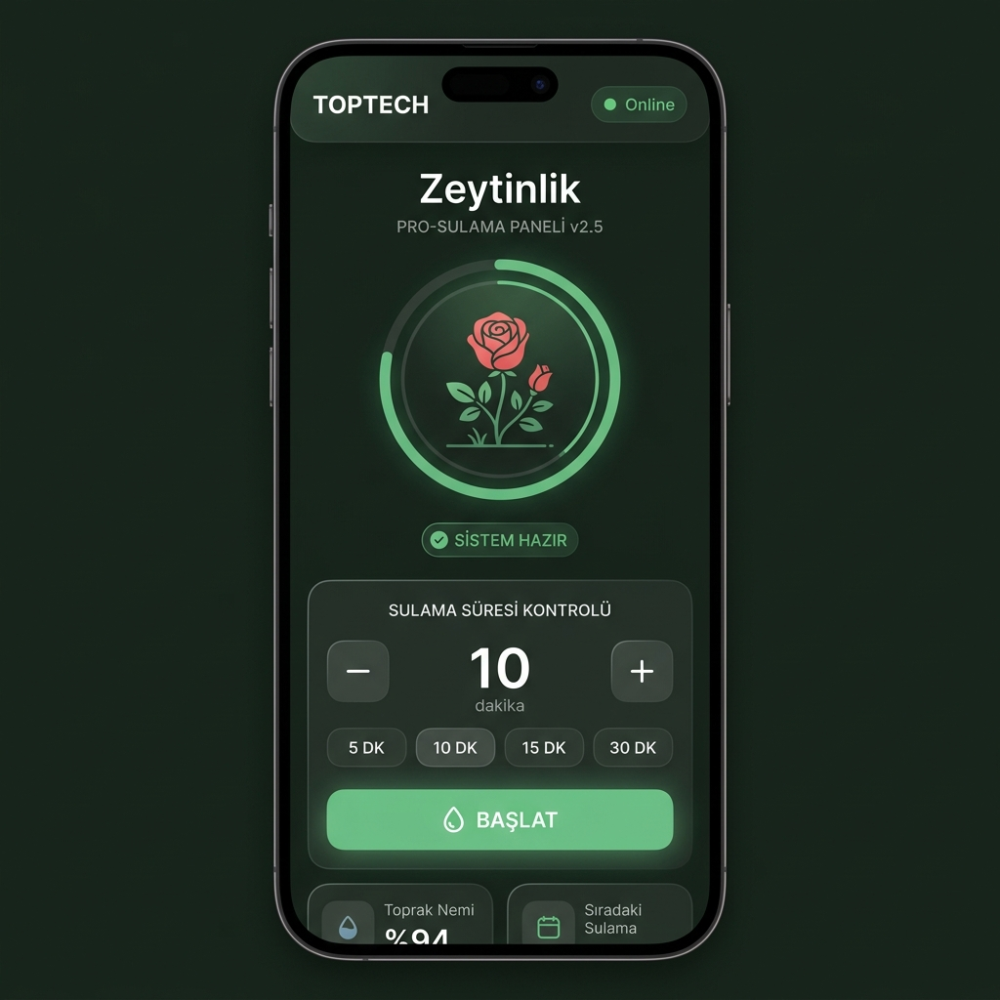
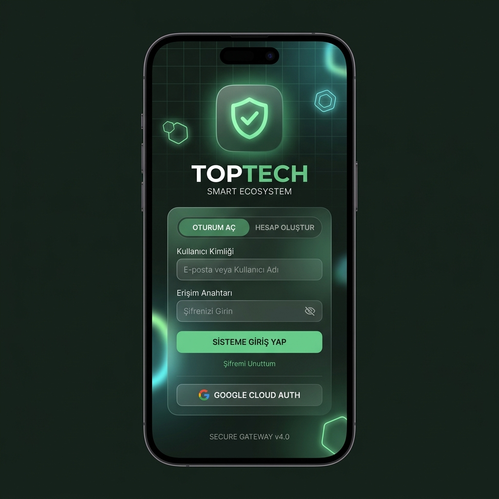
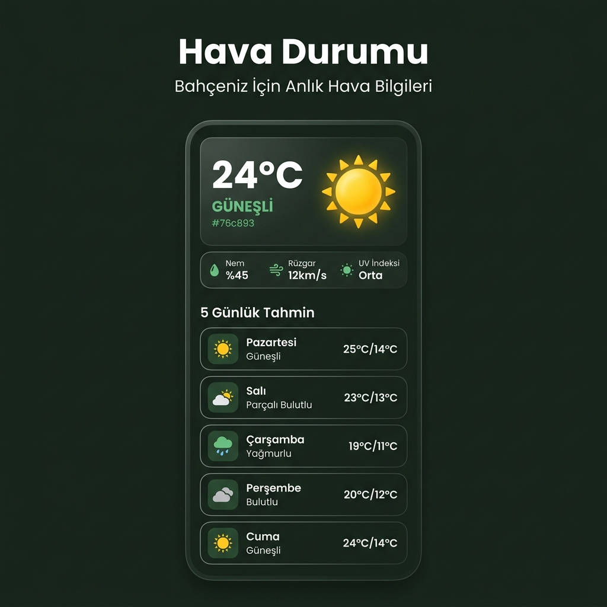
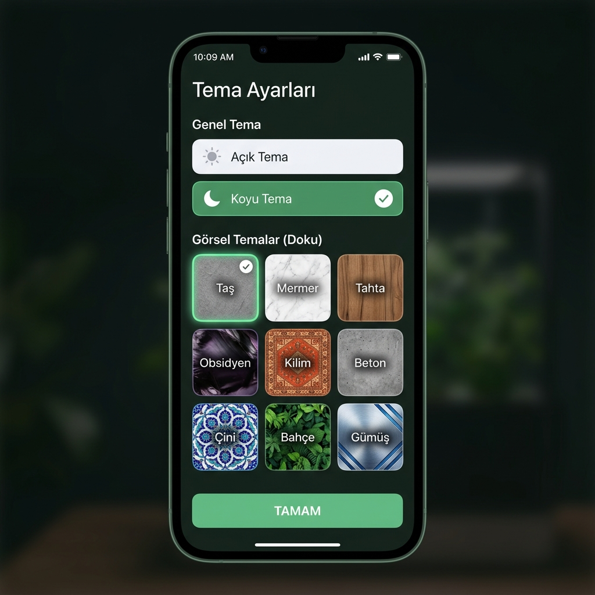
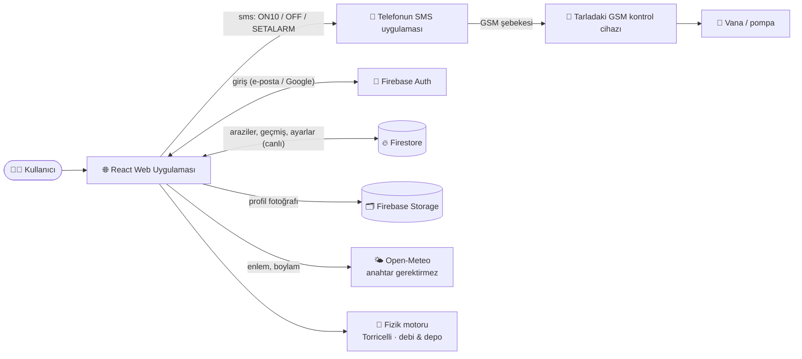
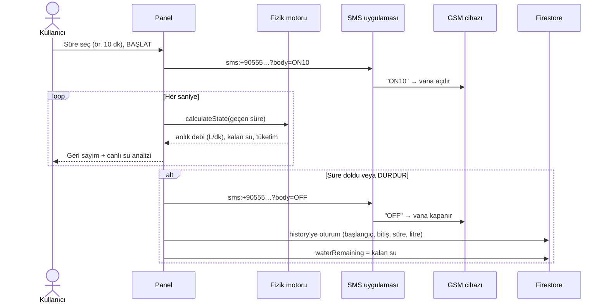
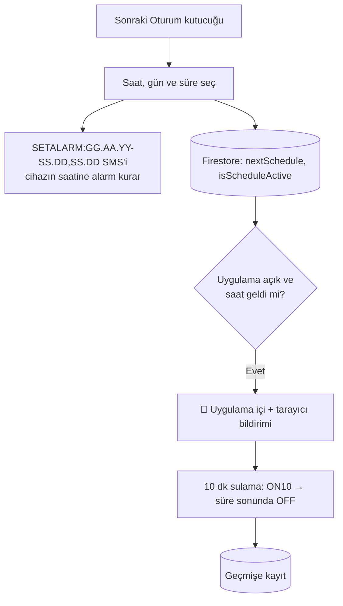

<div align="center">



# 🌿 TOPTECH Operasyon Yeşili

**Akıllı Bahçe & Tarım Arazisi Yönetim Paneli**

Nem takibi · Otomatik sulama · Hava durumu · Kaynak tasarrufu

[](https://react.dev)
[](https://www.typescriptlang.org)
[](https://vite.dev)
[](https://firebase.google.com)

</div>

---

## 📖 Hakkında

**TOPTECH Operasyon Yeşili**, akıllı bahçe ve tarım arazilerinin uzaktan izlenmesi, nem takibi, otomatik sulama yönetimi ve kaynak tasarrufu analizlerini gerçekleştirmek üzere tasarlanmış **mobil öncelikli (mobile-first)**, modern ve yüksek performanslı bir yönetim panelidir.

Uygulama, arazideki GSM modüllü sulama kontrol cihazlarına **SMS komutları** göndererek internet bağlantısı gerektirmeden sahada sulama başlatıp/durdurabilir. Aynı zamanda **Open-Meteo API** üzerinden arazilerin koordinatlarına dayalı gerçek zamanlı hava durumu verileri çeker ve tüm sulama geçmişini **Firebase Firestore** üzerinde saklar.

---

## 📸 Ekran Görüntüleri

<div align="center">

<table>
  <tr>
    <td align="center"><br /><b>Giriş Ekranı</b></td>
    <td align="center"><br /><b>Ana Panel</b></td>
  </tr>
  <tr>
    <td align="center"><br /><b>Hava Durumu</b></td>
    <td align="center"><br /><b>Tema Ayarları</b></td>
  </tr>
</table>

</div>

---

## ⚙️ Nasıl Çalışır?

### Genel mimari



### Manuel sulama oturumu



### Otomatik zamanlama



### Su hesabı (fizik motoru)

Depodan akan su, basınç yüksekliğine bağlı olarak azalır (Torricelli): depo boşaldıkça debi düşer. Varsayılan 3000 L depo, 0.5 m sehpa ve 300 adet 8 L/sa damlatıcı ile başlangıç debisi **≈18.5 L/dk**'dır. Sehpa yüksekliği, su yüksekliği, sulama tipi (damla / serbest akış), damlatıcı sayısı-debisi ve boru uzunluğu **Ayarlar → Sistem Bilgisi**'nden değiştirilebilir; panel anlık debi, kalan su ve tahmini boşalma süresini canlı gösterir.

---

## ✨ Özellikler

### 🌱 Sulama Yönetimi
- **SMS Tabanlı Sulama Kontrolü** — GSM modülü barındıran kontrol cihazlarına `ON`, `ON<dakika>`, `OFF` komutları gönderir
- **Zamanlayıcılı Sulama** — 1 ila 120 dakika arasında süre belirleyerek otomatik sulama başlatma
- **Hızlı Ön Ayarlar** — 5, 10, 15 ve 30 dakikalık tek dokunuşla sulama seçenekleri
- **Geri Sayım Zamanlayıcı** — Sulama süresince canlı geri sayım ve ilerleme takibi
- **Otomatik Planlama** — Belirli bir saatte otomatik sulama başlatma ve uygulama içi bildirim sistemi

### 🏞️ Çoklu Arazi Desteği
- Sınırsız arazi ekleme, düzenleme ve silme
- Her arazi için ayrı **telefon numarası** (SMS cihaz kontrolü)
- Her arazi için ayrı **GPS koordinatları** (hava durumu ve konum)
- Araziler arası hızlı geçiş ve aktif arazi vurgulama
- Google Haritalar entegrasyonu ile konum bulma

### 🌤️ Hava Durumu Takibi
- **Open-Meteo API** ile gerçek zamanlı hava durumu verisi
- Arazinin koordinatlarına göre otomatik hava sorgulama
- **5 günlük tahmin** (Güneşli, Bulutlu, Parçalı Bulutlu, Yağmurlu)
- Nem, rüzgar hızı ve UV indeksi göstergeleri
- Animasyonlu hava durumu ikonları (Motion kütüphanesi ile)

### 📊 Sulama Geçmişi & Analitik
- Takvim tabanlı sulama geçmişi görünümü
- Her sulama seansı için başlangıç/bitiş saati ve toplam süre kaydı
- Ay bazında gezinti ve sulama yapılan günlerin işaretlenmesi
- Firebase Firestore üzerinde kalıcı ve senkronize veri saklama

### 🎨 Dinamik Tema Motoru
**11 farklı tema** ile arayüzün renk, doku, ikon seti ve köşe yuvarlaklıkları (border-radius) dinamik olarak değişir:

| Tema | Tür | Vurgu Rengi |
|------|-----|-------------|
| Açık | Genel | `#76c893` Yeşil |
| Koyu | Genel | `#76c893` Yeşil |
| Taş | Dokulu | `#9ca3af` Gri |
| Mermer | Dokulu | `#d4af37` Altın |
| Tahta | Dokulu | `#d97706` Amber |
| Obsidyen | Dokulu | `#a855f7` Mor |
| Kilim | Dokulu | `#ef4444` Kırmızı |
| Beton | Dokulu | `#eab308` Sarı |
| Çini | Dokulu | `#0ea5e9` Mavi |
| Bahçe | Dokulu | `#22c55e` Yeşil |
| Gümüş | Dokulu | `#38bdf8` Açık Mavi |

### 🔐 Kimlik Doğrulama
- **Firebase Authentication** ile e-posta/şifre girişi
- **Google OAuth** ile tek tıkla oturum açma
- Kullanıcı profil fotoğrafı yükleme (Firebase Storage)
- Kullanıcı bazlı veri izolasyonu

### ⚙️ Ayarlar & Cihaz Yönetimi
- Su tankı kapasitesi ayarlama (100L – 15.000L arası slider)
- Cihaz batarya durumu takibi
- Güvenlik kamerası, güneş paneli, aydınlatma ve sensör durumları
- Bildirim tercihleri

---

## 🛠️ Teknoloji Yığını

| Katman | Teknoloji | Sürüm | Açıklama |
|--------|-----------|-------|----------|
| **Framework** | React | 19.x | UI bileşen kütüphanesi |
| **Dil** | TypeScript | 5.8 | Tip güvenli geliştirme |
| **Build Tool** | Vite | 6.x | Hızlı geliştirme sunucusu ve derleme |
| **Animasyon** | Motion (Framer) | 12.x | Sayfa geçişleri ve hava durumu animasyonları |
| **Veritabanı** | Cloud Firestore | — | Gerçek zamanlı NoSQL veritabanı |
| **Kimlik Doğrulama** | Firebase Auth | — | E-posta/şifre + Google OAuth |
| **Depolama** | Firebase Storage | — | Profil fotoğrafı depolama |
| **Hava Durumu API** | Open-Meteo | — | Ücretsiz, açık kaynak hava durumu API'si |
| **İkonlar** | Google Material Symbols | — | Tema bazlı dinamik ikon seti |
| **Stil** | Vanilla CSS + CSS Variables | — | Dinamik tema sistemi |

---

## 📂 Proje Yapısı

```
toptech-operasyon-yeşili/
├── App.tsx                  # Ana uygulama — yönlendirme, tema, Firebase abonelikleri
├── index.html               # HTML şablonu, fontlar ve stil dosyaları
├── index.tsx                # React DOM render başlangıç noktası
├── index.css                # Global stiller ve CSS değişkenleri
├── types.ts                 # TypeScript tip ve arayüz tanımlamaları
├── vite.config.ts           # Vite derleme konfigürasyonu
├── tsconfig.json            # TypeScript derleyici ayarları
│
├── lib/
│   ├── firebase.ts          # Firebase istemci ilklendirmesi (Auth, Firestore, Storage)
│   ├── db.ts                # Firestore CRUD ve gerçek zamanlı abonelik fonksiyonları
│   ├── themes.ts            # 11 tema konfigürasyonu (renk, doku, ikon, radius)
│   └── WaterIrrigationPhysicsEngine.ts # Torricelli tabanlı depo boşalma / debi hesabı
│
├── tests/                   # Vitest + Testing Library otomatik testleri
│
├── components/
│   ├── LoginView.tsx        # Giriş/Kayıt ekranı (Firebase Auth + Google OAuth)
│   ├── AppIntro.tsx         # İlk açılış tanıtım animasyonu
│   ├── Header.tsx           # Üst bar: çevrimiçi durumu, tema, profil
│   ├── Navigation.tsx       # Alt sekme barı (Panel, Hava, Geçmiş, Arazi, Ayarlar)
│   ├── Dashboard.tsx        # Ana kontrol paneli (sulama, gül animasyonu, zamanlayıcı)
│   ├── Gauge.tsx            # Dairesel nem göstergesi
│   ├── StatusTile.tsx       # Küçük bilgi kutuları (nem, pil, su)
│   ├── WeatherHero.tsx      # Dashboard hava durumu özeti
│   ├── WeatherView.tsx      # 5 günlük detaylı hava tahmini
│   ├── HistoryView.tsx      # Takvim tabanlı sulama geçmişi
│   ├── LandsView.tsx        # Arazi listeleme, ekleme, düzenleme, silme
│   ├── ScheduleModal.tsx    # Zamanlama güncelleme pop-up
│   └── Modal.tsx            # Yeniden kullanılabilir modal bileşeni
│
├── public/
│   ├── themes/              # 9 adet tema doku görseli (taş, mermer, tahta vb.)
│   └── lands/               # Varsayılan arazi görselleri
│
└── docs/
    └── screenshots/         # README için uygulama ekran görüntüleri
```

---

## 🗄️ Veritabanı Şeması (Firestore)

```
users/
  └── {user_id}/                          # E-posta bazlı kullanıcı dokümanı
        ├── email: string
        ├── lastLogin: timestamp
        ├── tankCapacity: number           # Su deposu kapasitesi (Litre)
        ├── isScheduleActive: boolean      # Otomatik zamanlama durumu
        ├── nextSchedule: string           # Planlanan sulama saati ("HH:MM")
        ├── nextScheduleDay: string        # Planlanan gün açıklaması
        │
        ├── lands/                         # Alt Koleksiyon: Araziler
        │     └── {land_id}/
        │           ├── name: string
        │           ├── location: string
        │           ├── sensorCount: number
        │           ├── image: string
        │           ├── phoneNumber: string
        │           ├── coordinates: string    # "enlem, boylam"
        │           └── createdAt: timestamp
        │
        └── history/                       # Alt Koleksiyon: Sulama Geçmişi
              └── {session_id}/
                    ├── landId: string
                    ├── landName: string
                    ├── date: string           # YYYY-MM-DD
                    ├── time: string           # HH:mm
                    ├── startTime: string      # HH:mm:ss
                    ├── endTime: string        # HH:mm:ss
                    ├── duration: string       # "5 dk 23 sn"
                    ├── icon: string
                    └── createdAt: timestamp
```

---

## 🚀 Kurulum ve Çalıştırma

### Gereksinimler

- **Node.js** v18 veya üzeri
- **npm** v9 veya üzeri

### Kurulum

```bash
# 1. Repoyu klonlayın
git clone https://github.com/AliKemalTopak/TopTech_Operation_Green.git
cd TopTech_Operation_Green

# 2. Bağımlılıkları yükleyin
npm install

# 3. Geliştirme sunucusunu başlatın
npm run dev
```

Uygulama varsayılan olarak `http://localhost:5173` adresinde açılacaktır.

### Diğer Komutlar

| Komut | Açıklama |
|-------|----------|
| `npm run dev` | Geliştirme sunucusunu başlatır (HMR aktif) |
| `npm run build` | Üretim için derleme yapar (`dist/` klasörüne) |
| `npm run preview` | Derlenmiş sürümü önizler |
| `npm run lint` | TypeScript tip kontrolü (`tsc --noEmit`) |
| `npm test` | Tüm otomatik testleri çalıştırır (Vitest) |
| `npm run test:watch` | Testleri izleme modunda çalıştırır |

---

## 📱 Kullanım Senaryoları

### Senaryo 1: İlk Kullanım ve Arazi Ekleme
1. Uygulamayı açın → Giriş ekranında e-posta/şifre ile kayıt olun veya **Google** ile giriş yapın
2. Tanıtım animasyonu sonrası **Ana Panel** açılır
3. Alt sekme çubuğundan **Araziler** sekmesine geçin
4. **"Arazi Ekle"** butonuna tıklayın
5. Arazi adı, GSM telefon numarası ve GPS koordinatlarını girin
6. **Google Haritalar** butonunu kullanarak koordinatları kolayca bulun
7. Kaydedin → Arazi listeye eklenir ve otomatik olarak aktif arazi seçilir

### Senaryo 2: Manuel Sulama Başlatma
1. **Panel** sekmesinde aktif arazi adını kontrol edin
2. `–` / `+` butonları veya hızlı ön ayarlar (5, 10, 15, 30 dk) ile süre belirleyin
3. Yeşil **"BAŞLAT"** butonuna basın
4. Cihazın GSM numarasına SMS uygulaması açılır (`ON10` komutu hazır)
5. SMS'i onaylayın → Geri sayım başlar ve gül animasyonu sulama ilerlemesini gösterir
6. Süre dolduğunda veya **"DURDUR"** butonuna basıldığında `OFF` komutu gönderilir
7. Sulama seansı otomatik olarak **Geçmiş** kaydına eklenir

### Senaryo 3: Otomatik Zamanlama
1. Panel'deki **"Sonraki Oturum"** kutucuğuna tıklayın
2. İstediğiniz saati ve günü seçin → Kaydedin
3. Toggle ile zamanlamayı **aktif** edin
4. Belirlenen saatte uygulama açıksa:
   - Uygulama içi sliding bildirim gösterilir
   - Tarayıcı push bildirimi gönderilir
   - 10 dakikalık otomatik sulama başlatılır

### Senaryo 4: Hava Durumu Takibi
1. Arazi ekleme sırasında koordinatları girdiğinizden emin olun
2. **Hava Durumu** sekmesine geçin
3. Aktif arazinin konumuna göre anlık sıcaklık, nem, rüzgar ve UV verilerini görün
4. **5 günlük tahmin** listesinde yaklaşan hava koşullarını kontrol edin
5. Yağmur tahmini varsa sulama planınızı buna göre ayarlayın

### Senaryo 5: Sulama Geçmişi İnceleme
1. **Geçmiş** sekmesine geçin
2. Takvimde sulama yapılan günler yeşil noktalarla işaretlenir
3. Bir güne tıklayın → O güne ait tüm sulama seansları listelenir
4. Seans kartına tıklayarak detaylı bilgi modalını açın:
   - Başlangıç ve bitiş saati
   - Toplam çalışma süresi
   - Hangi arazide yapıldığı

### Senaryo 6: Tema Kişiselleştirme
1. **Ayarlar** sekmesine gidin → **"Temalar"** butonuna tıklayın
2. **Açık** veya **Koyu** genel tema seçin
3. 9 dokulu temadan birini seçin (Taş, Mermer, Obsidyen vb.)
4. Tema anında uygulanır — renkler, köşe yuvarlaklıkları, ikonlar ve arka plan dokusu değişir
5. Tema tercihiniz `localStorage` üzerinde kalıcı olarak saklanır

---

## 🏗️ Mimari ve Teknik Detaylar

### SMS Sulama Kontrol Mekanizması
Uygulama, internet bağlantısı olmayan kırsal alanlardaki GSM modülü barındıran kontrol cihazlarını hedefler. Sulama komutu göndermek için cihazın telefon tarayıcısının `sms:` URI şemasını kullanır:

```
sms:<telefon_numarası>?body=ON       → Süresiz sulama başlat
sms:<telefon_numarası>?body=ON10     → 10 dakika sulama başlat
sms:<telefon_numarası>?body=OFF      → Sulamayı durdur
```

### Gerçek Zamanlı Veri Senkronizasyonu
Firebase Firestore `onSnapshot` dinleyicileri ile araziler, geçmiş ve kullanıcı ayarları gerçek zamanlı olarak senkronize edilir. Herhangi bir cihazda yapılan değişiklik anında diğer cihazlara yansır.

### Dinamik Tema Sistemi
Temalar CSS Variables üzerinden yönetilir. Her tema değişikliğinde `document.documentElement` üzerine aşağıdaki değişkenler enjekte edilir:

```css
--color-primary          /* Vurgu rengi */
--color-bg-dark          /* Arka plan */
--color-surface-dark     /* Kart yüzeyi */
--color-border-dark      /* Kenarlık */
--radius-default/lg/xl   /* Köşe yuvarlaklığı */
--theme-img              /* Doku görseli URL'si */
```

### Hava Durumu API Entegrasyonu
[Open-Meteo](https://open-meteo.com) ücretsiz API'si kullanılır. Arazinin `enlem, boylam` koordinatları ile sorgu yapılır:

```
GET https://api.open-meteo.com/v1/forecast
  ?latitude=39.93&longitude=32.85
  &current_weather=true
  &daily=weathercode,temperature_2m_max,temperature_2m_min
  &timezone=auto
```

---

## 🧪 Testler ve Doğrulama Sonuçları

Uygulamanın README'de vaat ettiği davranışları **gerçekten** yapıp yapmadığını doğrulayan otomatik test paketi [Vitest](https://vitest.dev) + [Testing Library](https://testing-library.com) ile yazılmıştır. Firebase ve tarayıcı API'leri (SMS `sms:` yönlendirmesi, `fetch`, `localStorage`) taklit edilerek uçtan uca kullanıcı akışları jsdom üzerinde çalıştırılır.

```bash
npm test
```

### Son çalıştırma sonucu

> 22 Ekim 2026 · Node.js 22 · Vitest 3.2 — **9 dosya, 88 test, 88 başarılı ✅, 0 başarısız** (+ emülatörde 12 güvenlik kuralı testi)

| Test dosyası | Test | Sonuç | Doğrulanan davranış |
|---|:-:|:-:|---|
| `tests/physics.test.ts` | 11 | ✅ | Torricelli fizik motoru: başlangıç debisi (300 damlatıcı × 8 L/sa → ~18.5 L/dk), kütle korunumu, sayısal integral ile kapalı form çözümünün örtüşmesi, boşalma süresi, kısmi depo, damla/serbest akış ve boru uzunluğu etkisi |
| `tests/db.test.ts` | 7 | ✅ | Firestore yolları (`users/{id}/lands`, `users/{id}/history`), yeni kullanıcıya varsayılan ayarlar, mevcut kullanıcının ayarlarının ezilmemesi, arazi CRUD, geçmiş kaydı, gerçek zamanlı dinleyiciler |
| `tests/themes.test.ts` | 22 | ✅ | 11 temanın varlığı, README'deki vurgu renkleri, geçerli hex renk/radius/ikonlar, doku görsellerinin `public/` altında bulunması |
| `tests/ScheduleModal.test.tsx` | 7 | ✅ | `SETALARM:GG.AA.YY-SS.DD,SS.DD` komutu, süreye göre kapanış saati, gece yarısı geçişi, 1–180 dk sınırı, geçmiş günlerin seçilememesi, SMS'in doğru numaraya gitmesi, numara yoksa uyarı |
| `tests/Dashboard.test.tsx` | 11 | ✅ | Süre ayarı (–/+ 1–120 dk, 5/10/15/30 ön ayarları), BAŞLAT/DURDUR, geri sayım bitince otomatik durdurma, canlı su tüketimi, depo yüzdesi, nem etiketi, zamanlama anahtarı |
| `tests/LandsView.test.tsx` | 7 | ✅ | Arazi listeleme, seçme, ekleme (ad + GSM no + koordinat), düzenleme, onaylı silme, hata bildirimi |
| `tests/HistoryView.test.tsx` | 5 | ✅ | Takvimde sulama günlerinin işaretlenmesi, gün/ay filtreleme, ay gezintisi, seans detayları (başlangıç/bitiş/süre/litre) |
| `tests/App.test.tsx` | 16 | ✅ | **Uçtan uca senaryolar:** BAŞLAT → `ON10` SMS, DURDUR → `OFF` SMS ve geçmişe kayıt + depodan düşüm; süre dolunca otomatik `OFF`; otomatik zamanlama saatinde bildirim + 10 dk sulama; Open-Meteo sorgusu ve 5 günlük tahmin; arazi değişince hava durumunun yenilenmesi; tema kalıcılığı; tank kapasitesi; depo doldurma; damlatıcı debisi ayarının akışa etkisi; **Güvenlik:** doğrulanmamış e-postayla veri yüklenmemesi ve doğrulama akışı; profil fotoğrafının kullanıcı kimliği altına yüklenmesi, resim olmayan/büyük dosyanın reddi. |
| `tests/LoginView.test.tsx` | 2 | ✅ | Yeni hesapta doğrulama e-postası gönderilmesi |

### Testlerin ortaya çıkardığı hatalar

| # | Bulgu | Durum |
|---|---|---|
| 1 | **Otomatik zamanlama hemen kapanıyordu:** Planlanan saatte `ON10` SMS'i gönderildikten hemen sonra `OFF` gönderiliyor ve geçmişe `0 dk 0 sn` kaydediliyordu (geri sayım henüz başlamadan "süre doldu" kontrolü tetikleniyordu). | ✅ Düzeltildi — `components/Dashboard.tsx` |
| 2 | **Damlatıcı debisi (2/4/8/12 L/h) ayarı etkisizdi:** Ayar Firestore'a kaydediliyor ama fizik motoruna iletilmediği için akış hızı her zaman 8 L/h ile hesaplanıyordu. | ✅ Düzeltildi — `components/Dashboard.tsx` |
| 3 | Geçmiş detayında ay adı `toUpperCase()` ile büyütüldüğü için "EKİM" yerine "EKIM" görünüyor (`toLocaleUpperCase('tr-TR')` kullanılmalı). | ⚠️ Kozmetik, açık |

### Test kapsamı dışında kalanlar

Gerçek Firebase Authentication (e-posta / Google OAuth) girişi, profil fotoğrafı yükleme (Firebase Storage), tarayıcı push bildiriminin fiilen gösterilmesi, telefonda SMS uygulamasının açılıp mesajın cihaza ulaşması ve canlı Open-Meteo yanıtları otomatik testlerde taklit edilmiştir; bunlar için gerçek cihazda manuel doğrulama önerilir.

---

## 🔐 Güvenlik ve Kullanıcı Verileri

Bu uygulama Firebase projesini (`toptech-717ee`) Flutter uygulamasıyla (TopTech reposu) paylaşır; iki uygulamanın kuralları tek bir `firestore.rules` dosyasındadır ve dosya iki repoda **aynıdır**.

| Veri | Yol | Kim erişebilir? |
|---|---|---|
| Ayarlar, araziler (GSM numarası, konum), sulama geçmişi | `users/{e-postadan üretilen kimlik}/…` | Sadece o e-postanın **doğrulanmış** sahibi |
| Profil fotoğrafı | Storage `profiles/{uid}/…` | Yükleme: sadece sahibi (sadece resim, ≤ 5 MB) · Görüntüleme: giriş yapmış kullanıcılar |
| Flutter uygulamasının verileri | `artifacts/remote-irrigation-app/…` | Sadece yönetici tarafından yetkilendirilmiş Flutter hesapları |

- **E-posta doğrulaması zorunludur.** Yeni hesap açılınca doğrulama e-postası gönderilir; doğrulanana kadar uygulama veri yüklemez ve kurallar erişimi reddeder. Google ile girişte e-posta zaten doğrulanmıştır.
- Kullanıcı kimliği e-postadan üretildiği için (`ali.k@x.com` → `ali_k_x_com`) farklı adresler aynı kimliğe düşebilir (`ali_k@x.com`). Doğrulama şartı sayesinde bir kimliği sadece gerçek e-posta sahibi kullanabilir.

### Kuralları yayınlama

```bash
firebase deploy --only firestore:rules,storage
```
veya Firebase konsolu → Firestore → Rules ve Storage → Rules sayfalarına `firestore.rules` ve `storage.rules` içeriğini yapıştırın.

> ⚠️ E-posta/şifre ile kayıt olmuş ama e-postasını hiç doğrulamamış mevcut kullanıcılar, kurallar yayınlandıktan sonra ilk girişte doğrulama ekranını görür ve doğrulayana kadar verilerine erişemez.

### Kural testleri

```bash
npm run test:rules   # Firestore + Storage emülatörü (Java gerekir)
```

> Son çalıştırma (22 Ekim 2026): **12/12 başarılı ✅**. Aynı testler önceki canlı kuralla (`request.auth != null` ile her şeye izin) çalıştırıldığında **7'si başarısız** oluyordu: giriş yapmış herhangi bir kullanıcı başkalarının arazilerini, telefon numaralarını ve geçmişini okuyup silebiliyordu.

---

## 🗺️ Yol Haritası

- [ ] **Firebase Cloud Functions** — API anahtarlarını sunucu tarafına taşıma
- [ ] **Gerçek IoT Sensör Bağlantıları** — ESP32/Arduino cihazlardan HTTP POST ile anlık nem verisi
- [ ] **AI Sulama Asistanı** — Gemini API ile optimal sulama önerileri
- [ ] **Otomatik SMS API** — Twilio entegrasyonu ile arka planda SMS gönderimi
- [ ] **PWA Desteği** — Çevrimdışı kullanım ve ana ekrana ekleme
- [ ] **Çoklu Dil Desteği** — İngilizce ve diğer diller

---

## 📄 Lisans

Bu proje **TOPTECH Labs** tarafından geliştirilmektedir. Tüm hakları saklıdır.

© 2025 TOPTECH Labs

---

<div align="center">

**TOP**<span>TECH</span> · Smart Ecosystem 🌿

</div>
